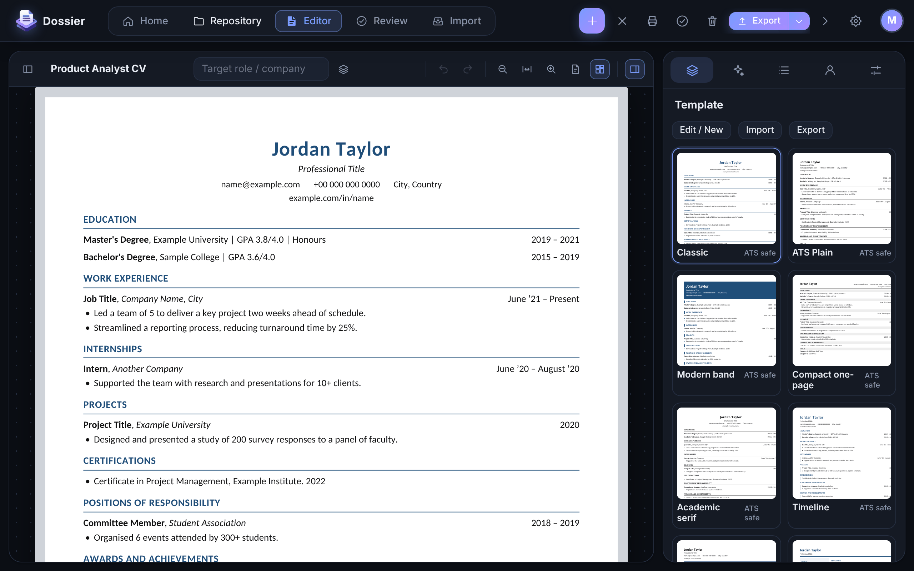
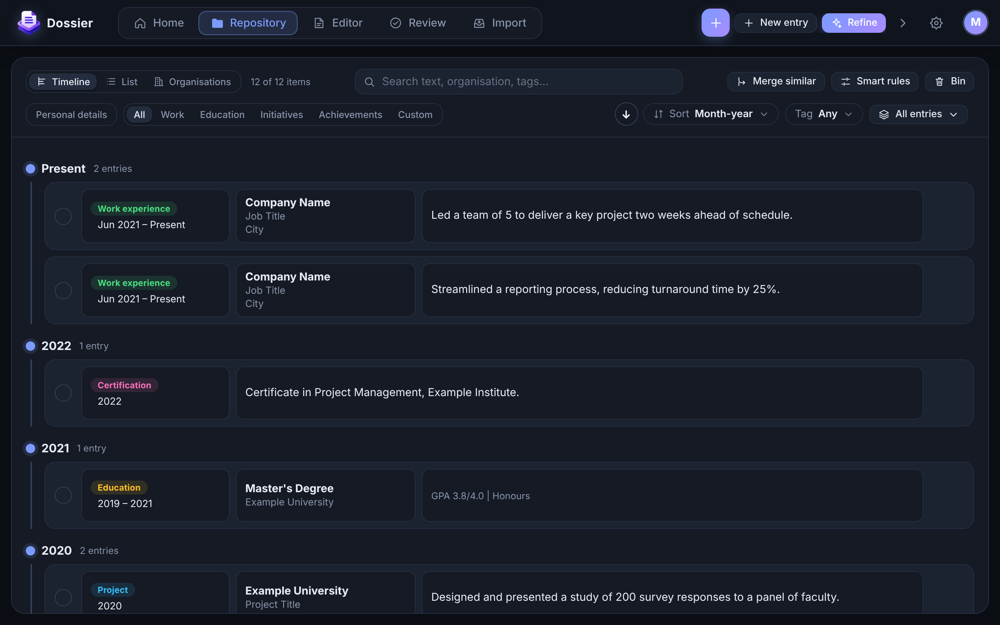
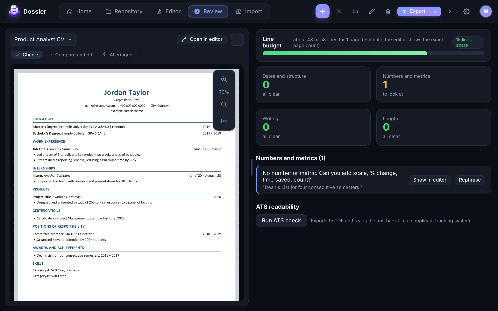
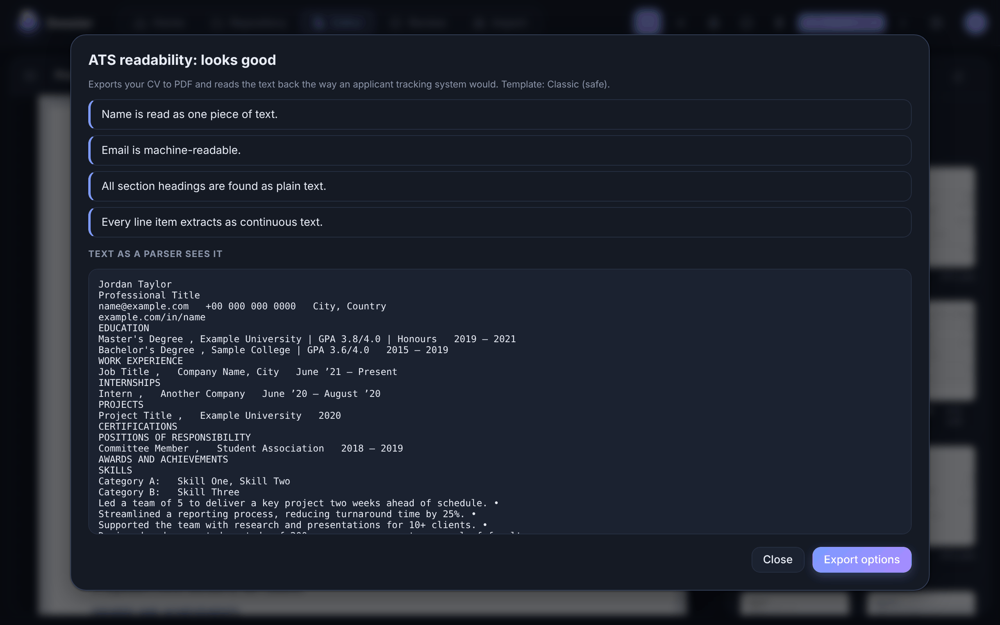

# Dossier
> Job seekers can keep every achievement in one place and build a tailored, parser-checked CV for each application, without retyping or reformatting a document each time.

  

**Try it:** [Releases](../../releases)  ·  **Status:** Active  ·  **Platform:** Windows desktop app

<!-- SCREENSHOT: hero -->

## Why this exists
- **Who:** Current and aspiring professionals looking to store and manage their achievements and applying for new roles across organisations.
- **Before:** One master CV to store all achievements, then manually editing individual line items to better suit different applications across roles or organisations. Locally stored versions with confusing names and having to open all files just to find the appropriate one for an application. Not being sure which CV was sent for which application and preparing differently for the interview.
- **Now:** Every achievement, role, qualification and certificate is stored once as an entry. Each CV is assembled from those entries, shown in a template of your choice, checked for how a parser will read it, and exported. Applications are maintained per role or per organisation each with their own cv, cover letter and JD.

## What it does
**Collect**
- Store achievements, work, education and certifications once, with alternative wordings you can pick per CV.
- Import old CVs (PDF, Word, text, HTML, JSON Resume) or a LinkedIn data export (.zip) and sort them into entries.

**Build**
- Pick entries into a CV, reorder them by dragging, and edit text in place in the live preview.
- Switch between built-in templates while editing; custom templates are supported.

**Check**
- Review gaps and overlaps, quantification prompts, writing checks and a line budget before you send.
- Run an ATS check that shows which lines a parser reads out of order, and jumps to them.

**Send and track**
- Export to PDF, PNG, DOCX, HTML or JSON.
- Keep each application's CV, cover letter and job description together in the Applications tab.

**Optional AI help**
- Rephrase entries and tidy imports with a local model (Ollama) or a hosted one (Gemini, Groq). Nothing runs automatically.

<!-- SCREENSHOT: key flow -->

## Quick start
1. Download `Dossier Setup x.y.z.exe` from [Releases](../../releases). It is unsigned, so Windows SmartScreen warns: choose *More info*, then *Run anyway*. Optionally check the SHA-256 in the release notes with `Get-FileHash "Dossier Setup x.y.z.exe" -Algorithm SHA256`.
2. Start Dossier and choose a working folder. Nothing works until one is chosen.
3. The Repository opens. Choose **New entry** and add an achievement.
4. Choose **New CV**, tick the entry, and pick a template.
5. Choose **Export**, then PDF. Expected result: the file appears in the `exports` folder inside your working folder.

Building from source: [Development](#development).

## Decisions and trade-offs
| Decision | Over | Because |
|---|---|---|
| Plain JSON files in a folder you choose | A hidden database or cloud account | You own your data and choose how to store it. No accounts required. |
| Local model (Ollama) as the default AI, hosted models optional | A hosted model as the default | Privacy and cost |
| Gemini and Groq with your own key | ChatGPT | ChatGPT's API is paid. May be added later. |
| Built-in templates plus ones you add by hand | A template marketplace | A simple template typically does more than a fancy one. |
| LinkedIn opens in its own window; you copy things across | Automating LinkedIn | No simple implementation possible for automation here. Keeping this tool focused on its primary aim was more important than this. |

**What I left out on purpose**
- No OCR for scanned PDFs and no `.doc` import (save as `.docx` or PDF first). This only benefits in cases where you have photos of the CV instead of an actual doc, but requires a lot more dedicated build effort, would also bloat app size for minimal return.
- No automatic input to or output from LinkedIn. Keeping this tool focused on its primary aim.

## Known limits
- No OCR for scanned PDFs, no `.doc` (save as `.docx` or PDF).
- Import grouping is best-effort; check the review screen.
- Word export is single column for multi-column templates; PDF is the intended look.
- Multi-column templates are marked ATS "tolerant", single-column ones "safe".
- Windows only. The installer is unsigned.
- Real Word rendering, the LinkedIn window and Windows drag-and-drop behaviour cannot be tested automatically; they are checked by hand using [WINDOWS_TEST_LIST.md](WINDOWS_TEST_LIST.md).

## Privacy and data
- Everything is stored in your working folder. Nothing is sent anywhere by default.
- Internet is used only when you ask: AI help (Gemini, Groq; Ollama stays on this PC), fetching a job page, site icons for links (the site's own icon, then Google's icon service), and the LinkedIn window. Names, email, phone and links can be removed before text is sent to an AI.
- API keys are encrypted with your Windows login and kept outside the working folder, so backups and exports never contain them.
- Custom templates cannot run scripts or load anything from the internet.
- The app works offline once installed; only the features above need a connection.
- No usage tracking or analytics is built in.

Recovery and logs

- Backups: made when a folder opens and while you edit (at most every 30 minutes, about two days kept). Settings > Data and backups to restore.
- Recycle bin: deleted entries and CVs stay 30 days (Settings > Recycle bin).
- Damaged files are set aside (quarantined) instead of deleted; data from a newer version is left untouched and reported.
- If the window stops working, a dialog offers to reload. Logs: `%APPDATA%\cv-builder\logs\app.log` (secrets and user names are redacted).

AI setup

- **Ollama** (local): install Ollama, then Settings > AI models shows the exact command to run.
- **Gemini / Groq**: paste an API key in Settings > AI models. You see what is sent before it leaves the PC.

Screen layout

Top bar: Home (Overview, CVs, Applications) | Repository | Editor | Review | Import | **+** (new entry / CV / application) | gear (Settings) | profile.
Import has the importer on the left and a LinkedIn window on the right (separate sign-in per account, shared across profiles only when you pick an account from another profile).

## Evidence
No usage numbers collected yet. One verifiable figure: 134 automated tests (unit and UI), counted by `npm test`, on 2026-11-21, at v1.10.7.

## Version history
Latest: **v1.10.10**. Full detail in [CHANGELOG.md](CHANGELOG.md) and [Releases](../../releases). First built 2026-10-23.
| Version | Date | What changed for the user |
|---|---|---|
| 1.0.2 | 2026-11-02 | First full-feature build: repository, editor, templates, exports, import, LinkedIn window, splash screen. |
| 1.3.2 | 2026-11-03 | Security hardening of the desktop shell. |
| 1.9.5 | 2026-11-18 | Refinement pass finished: edge-case tests, keyboard and screen-reader support, faster start. |
| 1.10.6 | 2026-11-21 | Bin and Archive on Home, Word export with photo and QR, ATS line locator, compact repository toolbar. |
| 1.10.10 | 2026-11-22 | Packaging fix, MIT licence, release checksum command. |

Earlier versions are archived builds restored from local backups; the source at each tag is the repository snapshot at upload, not the original code for that version.

## Feedback
Report problems or ideas in [Issues](../../issues). Useful to include: the Dossier version (Settings > About), what you did, what you expected, and the log file if the window stopped working. Please do not attach real CVs; use dummy data.

## How this was built
I owned the problem, scope, trade-offs and testing: I specified the features, directed the work, decided what to cut, and ran the Windows test lists myself. Most of the implementation was written by Claude (Anthropic), working from my written requirements and feedback, and shipped as numbered builds.

Development

- Install Node.js 20+, then double-click `run.bat` (first run installs packages) or run `npm install` then `npm start`.
- `npm run dist` builds the Windows installer into `dist/` (unsigned). `npm run checksum` then prints its SHA-256 and a block for the release notes.
- `npm test` runs the unit and UI suites (Node test runner, Playwright; UI tests use the browser harness in `dev/`).
- `npm run lint` checks for unused or undefined names.
- `npm run web` serves the interface in Chrome or Edge (file pickers use the browser; LinkedIn and Copy-file need the desktop app).
- The refinement history is in [REFINEMENT_PLAN.md](REFINEMENT_PLAN.md).

## Credits
Built with Electron, electron-builder, docx, JSZip and pdf.js. Reference projects looked at while planning: CVAurum, KiwiCV, JSON Resume, RenderCV, Reactive Resume.

## Licence
MIT, see [LICENSE](LICENSE). Copyright (c) 2026 dvynsh3.
